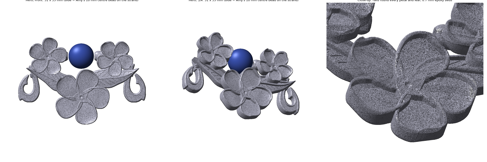
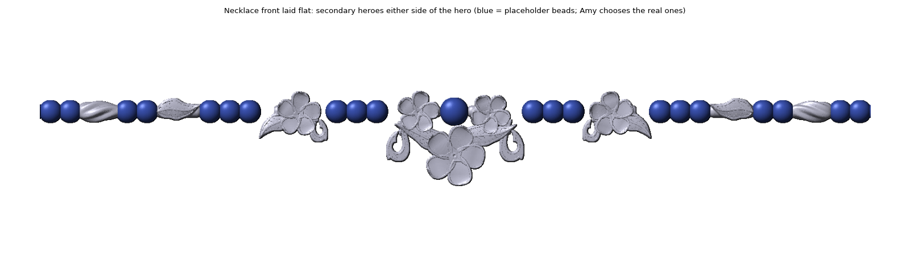
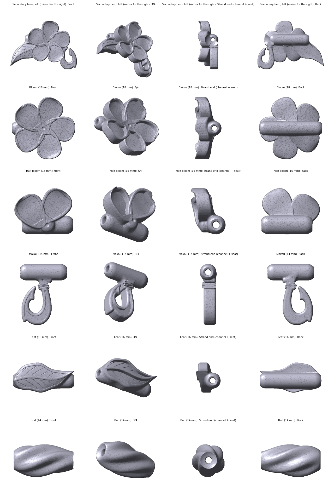

# Plumeria Echo Series

Strung focal pieces for Amy's beaded necklaces. The **hero** sits at the centre of the necklace, a **secondary hero** goes about a third of the way up each side, and small **echo** accents go between the beads. All of them use the same three layers:

1. **Plumeria blooms** (the stars)
2. **Leaves** with flowing, curved blades
3. **Makau** (fish hooks), enclosed so they can't snag




## Pieces

| File | Piece | Size (W × H × D, mm) |
|---|---|---|
| `echo_hero.stl` | Hero: three blooms, two leaves, two makau. The centre bead threads onto the strand between the side blooms. | 51 × 35 × 8 |
| `echo_secondary.stl` / `echo_secondary_right.stl` | Secondary hero (one bloom, leaf, small makau), left and mirrored right | 25 × 19 × 8 |
| `echo_bloom.stl` | Bloom accent | 18 × 18 × 8 |
| `echo_half_bloom.stl` | Half-bloom accent | 13 × 10 × 8 |
| `echo_hook.stl` | Makau accent | 12 × 15 × 4 |
| `echo_leaf.stl` | Leaf accent | 16 × 8 × 6 |
| `echo_bud.stl` | Twisted bud accent, carved like a bead | 14 × 8 × 8 |



## Stringing
- **Channel:** every piece has a 1.6 mm channel running side to side through a solid core, with at least 1.2 mm of resin around it. It fits beading wire, silk or doubled thread.
- **Mouths:** both ends of the channel are flared so the wire never rubs on a sharp edge. Each end also has a cupped seat so the next bead nestles in.
- **Hero centre bead:** the strand runs through tubes behind the two side blooms. The centre bead threads onto the wire in the 10 mm gap between them. A smaller bead plus spacers also works. To change the gap, edit `BEAD_GAP`.
- **Chain instead of beads:** run a short length of wire through the end tube and crimp it to the chain.

## Epoxy beds
Every petal, leaf and makau has a recessed bed, 0.7 mm deep, surrounded by a raised rail 0.65 mm wide, ready for an epoxy or UV-resin overlay. The bed depth sits on top of each shell, so there is always at least 1.2 mm of resin under the epoxy. The leaf veins are engraved into the bed floor, so they show through the epoxy.
- Use **UV resin or doming epoxy**. Thin epoxy runs downhill on the curved petals.
- Fill in thin coats, and keep the piece level while each coat cures.

## Print
- **Orientation:** the STLs are not oriented for printing. Tilt each piece about 30–45° in CHITUBOX with the back facing the plate. Put supports only on the back and the tube, never on the rails or petal edges.
- **Supports:** use the delicate settings from `../LESSONS_LEARNED.md`: 0.25 mm contacts, 0.20 mm depth.
- **Washing:** wash the channels and blow them out before the final cure.
- **Islands:** send the sliced `.ctb` and Claude can check it for floating islands.

## Checks (run on every build)
Each piece passes four checks: it is watertight, it is one solid body, a 1.2 mm wire passes along the whole channel, and the hero's 10 mm centre bead fits without touching resin.

## The makau outline
The makau outline is traced from a reference photo into `makau_outline.npz`, a mask of the hook and its lashing. The script then rounds every tip by 0.35 mm and adds the rim, the inlay bed and the grooved lashing.

## Regenerate
```bash
python echo_series.py --preview                 # renders only, for approval
python echo_series.py --voxel 0.04 --stl        # final STLs (the hero takes about 10 min)
python echo_series.py --only hero secondary --preview
```
