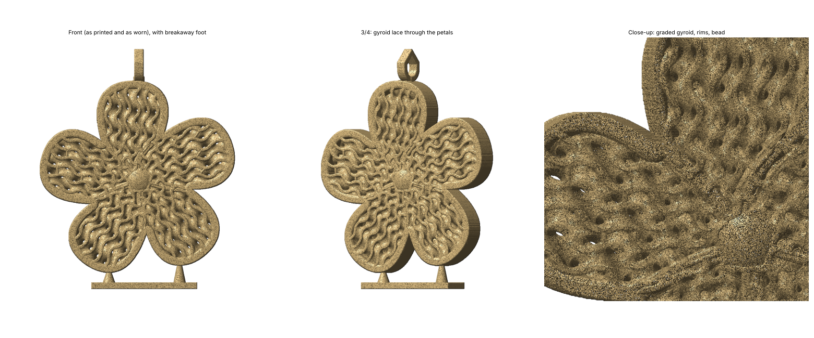

# Self-Supporting Gyroid Plumeria Pendant

A 34 × 42 mm resin pendant for the Elegoo Saturn 4 Ultra, **designed to print without supports**. It prints standing upright, exactly as it hangs.



## Why it needs no supports
- **Gyroid lace:** the petals are filled with a gyroid. It's a minimal surface, so it has no local low points: every layer grows out of the one below. The lace is graded finer toward the center (cell size 2.3 to 3.6 mm), and every petal carries an identical copy for five-fold symmetry.
- **Rotation:** the flower is rotated 84° so the only low points of the outline are the two bottom petal tips.
- **Teardrop bail:** a pointed arch whose top never overhangs flat.
- **Opening:** a 0.15 mm erode-then-dilate removes hair-thin slivers where the flat front and back faces graze a gyroid wall.
- **Micro-fillets:** 21 tiny 45° struts (0.36 mm) sit under the face edges where a gyroid wall slopes down toward the face. The script finds them by re-slicing and adds them automatically.
- **Breakaway foot:** the only extra part. It's a pad with thin necks (0.38 mm at the tip) to the two bottom tips. Snap it off and sand the two tips.

**Verified:** re-sliced at 0.05 mm layers on a 25 µm grid, the pendant has **0 floating islands** (anything at least 0.01 mm² with nothing within 50 µm below). Downward faces flatter than 30° make up 4.7% of the surface, all at gyroid saddles supported from both sides.

## Print
- **Placement:** put it on the plate as is: foot down, no supports, no raft.
- **Layer height:** 0.03–0.05 mm.
- **Washing:** wash well. The gyroid channels are about 1 mm wide, so agitate in IPA, or blow them out.
- **Resin:** standard or tough resin, about 1.7 mL. Castable resin also works if you want to cast it in metal.

## Regenerate
```bash
python3 gyroid_pendant.py                # 40 mm, repairs islands automatically
python3 gyroid_pendant.py --size 32      # smaller
```
Each repair pass takes about 5 minutes at full resolution.
