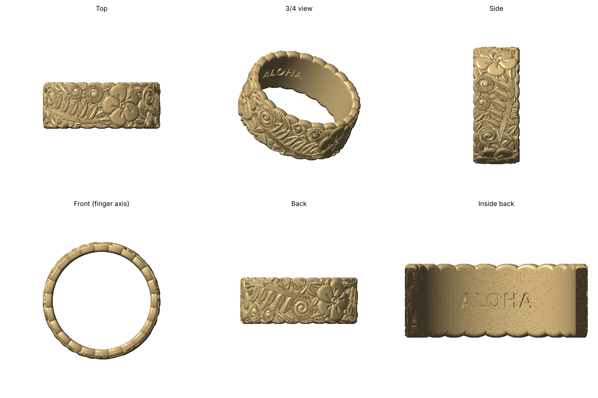

# Hawaiian Heirloom Band

Resin (MSLA) ring for the Elegoo Saturn 4 Ultra, in the style of hand-engraved Hawaiian heirloom jewelry.



- **8 mm wide band.** The design repeats three times around the ring: a raised plumeria, a curling ocean-wave scroll with combed hatching, and a hatched vine with a spray of leaves.
- **No bare spots.** Every open space is filled automatically with small wave curls, leaves tucked behind the main motifs, and crescent sweeps, the way traditional heirloom engraving covers the whole band.
- **Engraved look.** Each raised element is bevelled down toward its engraved outlines. The background is recessed 0.4 mm and has a stippled, matte texture, so the design catches the light.
- **Scalloped edges:** a row of shallow arcs about 2.6 mm long along each edge, with the top and bottom rows offset half a scallop. `SCALLOP_PITCH` and `SCALLOP_DEPTH` at the top of the script control the size.
- **Comfort-fit inside**, with **ALOHA** engraved at the back.

| File | US size | Inner diameter |
|------|---------|----------------|
| `heirloom_band_US6.stl` | 6 | 16.51 mm |
| `heirloom_band_US7.stl` | 7 | 17.32 mm |
| `heirloom_band_US8.stl` | 8 | 18.13 mm |

Each band uses about 0.6 mL of resin. All meshes are watertight single solids.

## Other sizes / options

Requires `numpy scipy scikit-image trimesh manifold3d matplotlib`. The script reuses helpers from `../plumeria-ring/plumeria_ring.py`.

```bash
python3 heirloom_band.py --size 6.5
python3 heirloom_band.py --size 7 --width 6        # narrower band
python3 heirloom_band.py --size 7 --text "MAHALO"  # or --text "" for none
```

The artwork is laid out in `draw_unit()` as plumeria, scroll, vine and leaves, so elements can be moved, resized or added there.

## Print settings (Saturn 4 Ultra)

- **Layer height:** 0.03 mm, or 0.02 mm for the crispest hatching.
- **Orientation:** stand the band upright on edge, tilted about 30–45°, with supports touching only the inside and one edge. Keep supports off the engraved outer face.
- **Supports:** light, with small contact tips.
- **After printing:** wash well so the stippled background and fine grooves don't hold uncured resin. A dark antique wash or paint wiped off the high points makes the engraving pop, just like oxidized silver heirloom pieces.
- **Resin:** tough or ABS-like resin to wear the ring directly, or castable resin to cast it in silver or gold.
