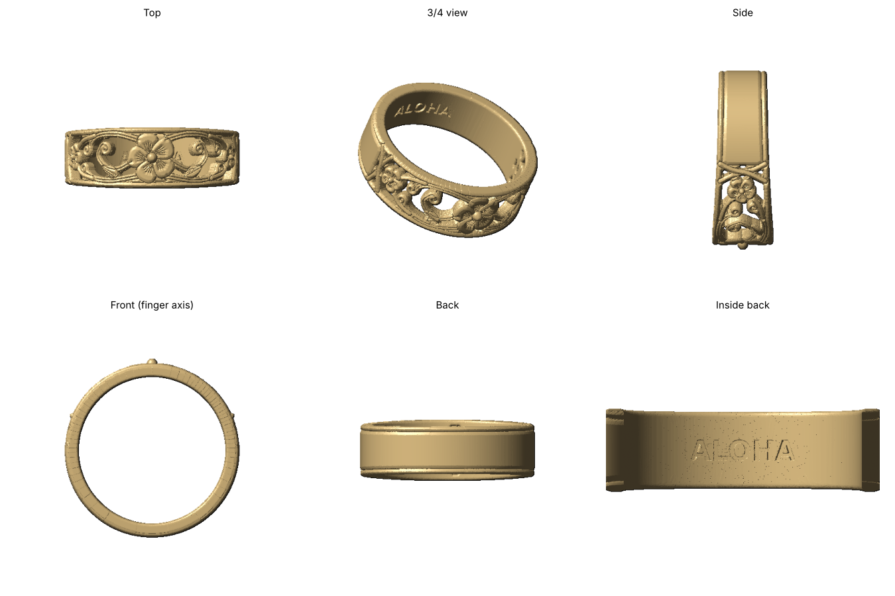

# Hawaiian Openwork Plumeria Band

Resin (MSLA) ring for the Elegoo Saturn 4 Pro: a pierced band where flowers, vines and curls stand as solid metal against through-cut voids.



- **Front section:** 30 mm long, 7 mm wide at the center flower, easing to 6 mm where it meets the shank. It's framed by slim rails.
- **Center plumeria:** raised bead center and engraved fan lines on each petal.
- **Each side, center outward:**
  - A veined leaf on the lower vine.
  - An S-vine rolling up into a big curl.
  - A long vine arcing along the top rail.
  - A pair of small curls.
  - A bead-center side flower on stems.
  - Crossing vines.
- **Back:** a plain solid shank with rail ridges, and **ALOHA** engraved inside.

| File | US size | Inner diameter |
|------|---------|----------------|
| `openwork_band_US6.stl` | 6 | 16.51 mm |
| `openwork_band_US7.stl` | 7 | 17.32 mm |
| `openwork_band_US8.stl` | 8 | 18.13 mm |

Each band uses about 0.4 mL of resin. All meshes are watertight single solids, and every piece of the openwork is connected.

## Other sizes / options

Requires `numpy scipy scikit-image trimesh manifold3d matplotlib`. The script reuses helpers from `../plumeria-ring` and `../heirloom-band`.

```bash
python3 openwork_band.py --size 6.5
python3 openwork_band.py --size 7 --text "MAHALO"   # or --text "" for none
```

The layout lives in `compose()`. The script refuses to build a design with floating pieces, and it fills voids too narrow to print cleanly.

`openwork_band_concept.py` holds the alternative concept-sheet version: sculpted surfaces, a narrower band, and an optional `--stone` 4-prong setting. It's kept for comparison.

## Print settings (Saturn 4 Pro)

- **Layer height:** 0.03 mm, or 0.02 mm for the finest vein lines.
- **Orientation:** stand the band on edge, tilted about 30–45°, with the openwork front facing up and away from the plate. Put supports on the plain shank and inside edge, not on the vines.
- **Resin:** the vines are about 0.7 mm thick, so use a tough or ABS-like resin to wear the print. Castable resin for silver or gold is the sturdiest option.
- **After printing:** wash and cure thoroughly. An antique wash wiped off the high points makes the petals and leaf veins stand out.
