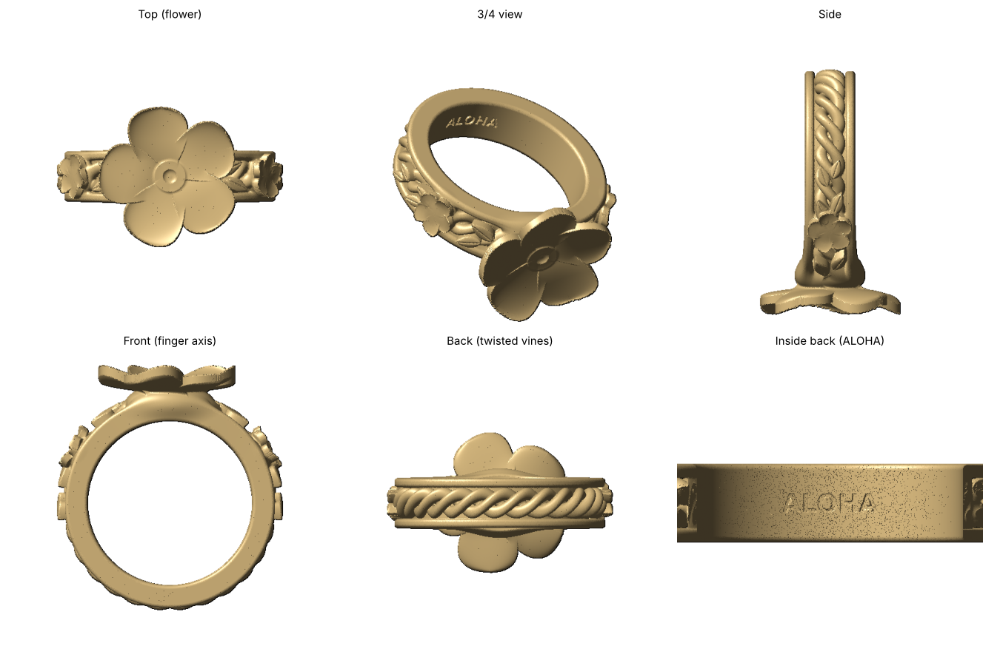

# Plumeria Ring: twisted three-vine band with edge rails

Resin (MSLA) ring for the Elegoo Saturn 4 Pro.



- **Top:** 5-petal plumeria (about 14.5 mm across). The petals are cupped, with the edges and tips curving up slightly, and they overlap in a pinwheel around a recessed throat.
- **Band:** three vines twisted like a rope, with small leaves along the shoulders and a small plumeria on each side. A solid rounded rail runs along each edge, framing the vines like a channel.
- **Inside:** a smooth comfort liner with **ALOHA** engraved at the back.

| File | US size | Inner diameter |
|------|---------|----------------|
| `plumeria_ring_US6.stl` | 6 | 16.51 mm |
| `plumeria_ring_US7.stl` | 7 | 17.32 mm |
| `plumeria_ring_US8.stl` | 8 | 18.13 mm |

Each ring uses about 0.85 mL of resin. All meshes are watertight.

## Other sizes / options

```bash
pip install numpy scipy scikit-image trimesh fast-simplification matplotlib
python3 plumeria_ring.py --size 6.5            # any US size, halves OK
python3 plumeria_ring.py --size 7 --text "MAHALO"
python3 plumeria_ring.py --size 7 --text ""    # no engraving
python3 render_preview.py plumeria_ring_US7.stl preview.png
```

The design knobs are the constants at the top of `plumeria_ring.py`: vine thickness, twist count, flower size, and so on.

## Print settings (Saturn 4 Pro)

- **Layer height:** 0.03 mm. Jewelry detail benefits from thin layers.
- **Orientation:** stand the ring on edge, finger hole facing sideways, with the flower tilted 30–45° up and away from the plate. Supports then land on the back rails and under the petals. Keep supports off the face of the flower and off the inside liner.
- **Supports:** light/medium, with small contact tips around 0.25–0.3 mm. Add a few under each petal tip.
- **Resin:** use a tough or ABS-like resin to wear the ring directly. For a silver or gold version, print in castable resin and cast it.
- **Fit:** resin can shrink slightly. Print the size you want first; if it's tight, regenerate at +0.25 or +0.5 of a size.
